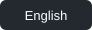

# FORM/SOUND

Учебный концепт интерфейса сайта для музыкального фестиваля.

## Что реализовано

- Адаптивная вёрстка и мобильное меню.
- Программа двух дней с переключением мышью и клавиатурой.
- CSS-анимация с поддержкой уменьшения движения.

## Локальный запуск

Откройте `index.html` для английской версии или `ru.html`.

## Шрифты

Space Grotesk, Overpass Mono, Manrope, JetBrains Mono.
